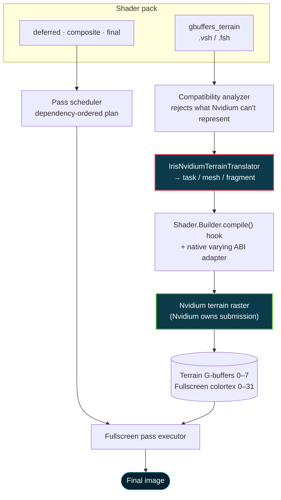

<div align="center">



<br>


**Iris-style shader packs on top of Nvidium's mesh-shader terrain.**

[Install](#-install) · [Architecture](#-architecture) · [Status](#-where-things-stand) · [Data contract](#-what-nvidium-can-actually-provide) · [CI](#-how-this-branch-is-kept-honest) · [Build](#-build-from-source) · [Roadmap](#-roadmap)

</div>

<br>

> [!WARNING]
> **Experimental.** This branch extends Nvidium's native terrain pipeline and translates Iris `gbuffers_terrain` programs into it. The translation and pass machinery is implemented and audited in CI against pinned upstream sources, but **in-game rendering has not been verified.** Mixin application, shader linking, visual correctness and performance all still need in-game validation.

> [!CAUTION]
> This is a **separate distribution** of CAUSTIQ. It keeps the Fabric mod ID `caustiq` and ships as `caustiq-nvidium-*.jar`. **Install only one CAUSTIQ build per game instance** — never this one alongside the [`main`](https://github.com/ItsDropper/CAUSTIQ) build.

## ✦ What this branch is

[Nvidium](https://github.com/MCRcortex/nvidium) replaces Sodium's terrain backend with a GPU-driven **task/mesh/fragment** pipeline. That's fast — and it has no idea what an Iris shader pack is. By default Nvidium steps aside whenever Iris shaders are active.

The `nvidium` branch builds the missing bridge, **without taking over terrain submission**:

- Nvidium still owns chunk submission and rasterisation.
- CAUSTIQ extends Nvidium's vertex and interpolant formats with the data packs expect, translates a pack's terrain program into Nvidium's stages, routes the output into MRT colour targets, and then runs the pack's fullscreen passes over them.
- Anything it *can't* represent is **rejected before shader link** — never guessed.

## ⚡ Install

| Requirement | Version |
|---|---|
| Minecraft | 1.21.11 |
| Fabric Loader | ≥ 0.20.1 |
| Sodium | **exactly** 0.8.12 |
| Nvidium | **exactly** 0.4.3-beta13-1.21.11 |
| Java | ≥ 21 |

The exact pins are enforced in `fabric.mod.json`: Nvidium-specific mixins target that precise method surface, so other versions won't load.

1. [Build](#-build-from-source) the mod (or take the `caustiq-<commit-sha>` JAR artifact from a successful GitHub Actions run) and put `caustiq-nvidium-*.jar` in `.minecraft/mods/` alongside Sodium and Nvidium.
2. Copy a shader pack into `.minecraft/shaderpacks/` — the bundled **Lumina** pack (`build/distributions/caustiq-lumina-<version>.zip`) is written for this branch's terrain pipeline and shadow map ([details](examples/caustiq-lumina/README.md)); **Stillwater** (`caustiq-stillwater-<version>.zip`) is a lighter final-pass grade that works as a first test. *Don't extract either.*
3. In-game: **Options → Video Settings → Caustiq Shaders**, pick a pack, enable Caustiq.

> [!TIP]
> **Taking artifacts from GitHub Actions?** GitHub wraps each one in an outer ZIP. Extract it first; the inner file is the one to use.

## ⚙️ Architecture



<details>
<summary><b>1 · Extended terrain vertex &amp; interpolant ABI</b></summary>
<br>

Nvidium's compact terrain format has no room for Iris attributes. CAUSTIQ forces Nvidium's Sodium-compatible base format, then supplies a stride-extended chunk vertex (**40 bytes**) that carries Iris-compatible octahedral normals, block IDs, mid-texture coordinates, mid-block offsets and tangents.

On the shader side, a **native varying adapter** transforms the TASK/MESH/FRAGMENT source set before OpenGL linking, adding a matched mesh-output / fragment-input interface for:

- raw vertex tint
- lightmap UV
- region-transformed, camera-relative position
- geometric face normal
- packed mip / alpha-cutoff material flags

Nvidium's existing UV and pre-lit colour varyings are preserved. The adapter disables Nvidium's optional fragment-barycentric define so the interpolant block is actually emitted (trading a little of that optimisation for the extra data), **fails closed if upstream shader anchors change**, and is installed only when Nvidium is detected.

</details>

<details>
<summary><b>2 · Terrain program translation</b></summary>
<br>

`IrisNvidiumTerrainTranslator` rewrites a `gbuffers_terrain` vertex/fragment pair into Nvidium's pipeline: the vertex `main` runs once per emitted Nvidium mesh vertex, Iris varyings are appended to Nvidium's interpolant block, and fragment outputs (`gl_FragData`, `layout(location)`, `RENDERTARGETS`/`DRAWBUFFERS`) are mapped to MRT locations.

Common Iris uniforms are aliased onto what Nvidium really binds (`gtexture`, `lightmap`, `gbufferModelView`, `gbufferProjection`, `cameraPosition`, `frameCounter`, `fogColor`, `viewSize`, …). Unsupported inputs are **rejected before compilation** — the translator never substitutes a guessed value for a missing resource.

Nvidium's Iris opt-out is overridden only when CAUSTIQ has a prepared terrain adapter for the current world.

</details>

<details>
<summary><b>3 · MRT G-buffers</b></summary>
<br>

`NvidiumGBufferTargets` temporarily adds CAUSTIQ's auxiliary attachments to the framebuffer Nvidium is rasterising into, then restores the original colour/depth attachments and draw-buffer routing straight after the draw.

- **Attachment 0** stays Nvidium's normal shaded terrain colour.
- **Attachments 1–7** are the Nvidium terrain G-buffer outputs; that native terrain adapter remains limited to seven auxiliary outputs.
- Fullscreen deferred/composite/final passes can address **colortex0–colortex31**. The executor allocates independent ping-pong textures for targets beyond Nvidium's seven terrain attachments and maps fragment output slots to compact framebuffer attachments, so high-numbered colortex targets do not consume equally high GL attachment indices.
- Pack-declared formats, independent X/Y scales, nearest/linear filtering, mipmaps, clear colours and persistent-target state are applied to fullscreen targets. Simultaneous outputs still obey the active GL draw-buffer/attachment limits.

</details>

<details>
<summary><b>4 · Pass scheduling &amp; execution</b></summary>
<br>

The `IrisTerrainPassScheduler` turns a pack's program set and `colortex` declarations into a deterministic, dependency-ordered plan (dimension overrides are never silently merged with the base set). `IrisGlPassExecutor` then runs the **deferred → composite → final** fullscreen passes in that order, with per-target ping-pong, scaled storage, persistent state and compact MRT routing.

Custom `texture.<name>` image assets are decoded and uploaded as managed `sampler2D` textures for both terrain and fullscreen programs. Custom `uniform.*` and `variable.*` declarations support float/int/bool and vec2/vec3/vec4 values, arithmetic, conditionals and common scalar math functions. Non-2D sampler types and vector-valued expression operations remain unsupported.

Shadow passes and compute/geometry/tessellation passes are **not** executed; they raise a clear error instead of rendering something wrong.

</details>

## 📊 Where things stand

| Area | | Notes |
|---|:-:|---|
| Renderer-stack validation (Sodium + Nvidium) | ✅ | Detected through Fabric Loader mod IDs |
| Final-colour post-process | ✅ | Single-input pass, shared with `main` |
| Native vertex/interpolant ABI extension | ✅ | 40-byte terrain vertex + varying adapter |
| Iris pack model, parser & block properties | ✅ | |
| Terrain compatibility analyzer | ✅ | Rejection gate, not a translator |
| `gbuffers_terrain` → Nvidium translator | ✅ | Fails closed on unsupported inputs |
| MRT terrain G-buffers | ✅ | Nvidium terrain attachments 1–7 |
| Fullscreen colortex allocator | ✅ | colortex0–31, compact MRT slots, scaling, ping-pong and persistence |
| Custom textures + uniforms | 🟡 | Managed custom sampler2D images; scalar expressions and typed scalar/vector uniforms |
| Pass scheduler + fullscreen executor | ✅ | `deferred`, `composite`, `final`; GL output limits checked |
| **In-game verification** | ⬜ | **Not done** — build success ≠ working renderer |
| Shadow rendering | ⬜ | Needs a light-space Nvidium terrain pass |
| Depth, compute, geometry/tessellation passes | ⬜ | |
| Full Iris expression VM and non-2D sampler types | ⬜ | |
| Validation against real packs & benchmarks | ⬜ | |

## 🔬 What Nvidium can actually provide

CAUSTIQ describes this honestly in `NvidiumIrisTerrainAbi`: a *capability* contract for Nvidium 0.4.3-beta13-1.21.11, not a claim that arbitrary Iris data exists.

| Iris semantic | Availability |
|---|:-:|
| `gl_Normal`, `iris_Normal`, `mc_Entity`, `mc_midTexCoord`, `at_midTexCoord`, `at_midBlock`, `at_tangent` | ✅ exact |
| `lmcoord`, `gl_MultiTexCoord1` / `vaUV2`, `gtexture`, `lightmap`, `gbufferModelView`, `gbufferProjection`, `cameraPosition`, `frameCounter`, `fogColor` | ✅ exact |
| `gl_Vertex` / `vaPosition`, `gl_MultiTexCoord0` / `vaUV0`, `gl_Color` / `vaColor`, matrix inverses, `viewWidth` / `viewHeight`, `frameTimeCounter` | 🟡 derived |
| `viewSpacePosition` | ❌ unavailable — Nvidium's position is region-transformed and camera-relative, not Iris view space |
| `normals`, `specular`, `depthtex1`, Distant Horizons / Voxy depth textures, `taa_offset` | ❌ rejected at translation |
| `colortex15` | 🟡 available to fullscreen passes; not a Nvidium terrain attachment |

Two caveats worth knowing: the extra normal is the **per-triangle geometric normal** reconstructed from transformed packed positions (degenerate triangles are guarded), not a smooth interpolated vertex normal; and the audited sampler bindings are the terrain atlas on unit 0 and Minecraft's lightmap on unit 1.

## 🧪 How this branch is kept honest

Because it hooks into someone else's renderer internals, this branch leans hard on CI. On every push to `main` or `nvidium`:

- **Pinned Nvidium source audit** — downloads Nvidium at a fixed revision and asserts that every method signature, field and shader anchor the mixins rely on still exists.
- **Pinned Photon terrain audit** — translates every dimension of a pinned [Photon](https://github.com/sixthsurge/photon) revision against Nvidium's real task/mesh/fragment stages. The workflow fails if that test is *skipped*, not just if it fails.
- **Combined integration test** — native ABI adapter and Iris translator composed against the pinned sources.
- **GLSL validation** with `glslangValidator`, plus unit tests across the parser, analyzer, scheduler, G-buffers and bridges.
- **JAR audit** — checks `fabric.mod.json` pins, the full mixin list and required classes, and that the artifact is named `caustiq-nvidium`.

> [!NOTE]
> These prove the translated shaders *compose with the pinned Nvidium sources*. They don't prove the frame looks right on a real GPU.

**Upgrading Nvidium?** Update the Nvidium and Sodium pins together, update the pinned source revision in CI, and re-verify that every mixin applies.

## 🔨 Build from source

| | |
|---|---|
| Minecraft | 1.21.11 |
| Java target | 21 bytecode |
| Build JDK | **25** (current Loom requirement) |
| Fabric Loader | 0.20.1 |
| Sodium | **0.8.12 required at runtime**; compiled against Sodium's internal chunk-format types (via Modrinth) |
| Nvidium | 0.4.3-beta13-1.21.11 — required at runtime |
| Mappings | Official Mojang |

```bash
# Linux / macOS
./gradlew build

# Windows
gradlew.bat build
```

Produces `build/libs/caustiq-nvidium-*.jar` and the Lumina and Stillwater shader ZIPs in `build/distributions/`.

## 🗺️ Roadmap

- [ ] **In-game validation** of mixin application, shader linking and visuals on the pinned Sodium + Nvidium stack.
- [ ] **Shadows** — a light-space Nvidium terrain pass.
- [ ] **Depth & remaining resources** — depth attachments, `depthtex1`, specular/normal buffers, and additional Iris built-in samplers.
- [ ] **Compute, geometry and tessellation** pass support.
- [ ] **GLSL** — AST-based transforms in place of regex rewriting.
- [ ] **Validation** — Complementary Reimagined, BSL and other real packs against Iris output, with Nvidium benchmarked against Sodium.

<br>

<div align="center">

Made by [**ItsDropper**](https://github.com/ItsDropper) &nbsp;·&nbsp; *light, bent through water.*

[← Back to the main branch](https://github.com/ItsDropper/CAUSTIQ)

</div>
