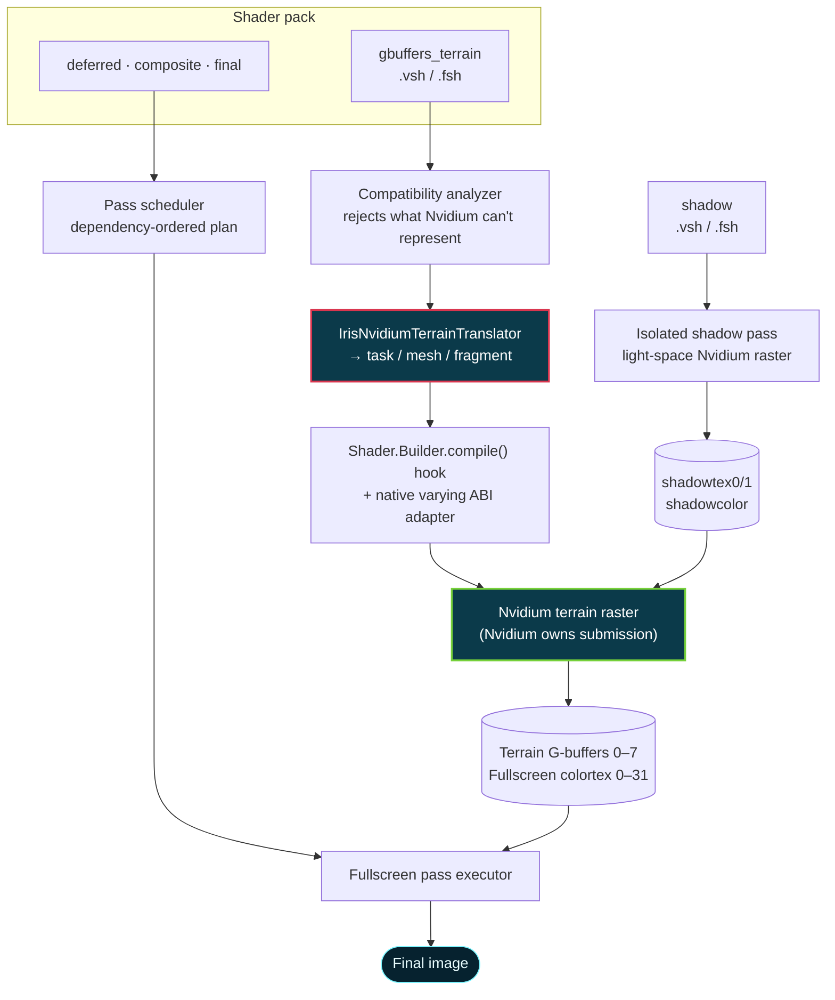

<div align="center">


<br>


**Iris-style shader packs on top of Nvidium's mesh-shader terrain.**

[Install](#-install) · [Architecture](#-architecture) · [Status](#-where-things-stand) · [Data contract](#-what-nvidium-can-actually-provide) · [CI](#-how-this-branch-is-kept-honest) · [Build](#-build-from-source) · [Roadmap](#-roadmap)

</div>

<br>

> [!WARNING]
> **Experimental.** This branch extends Nvidium's native terrain pipeline and translates Iris `gbuffers_terrain` programs into it. The translation and pass machinery is implemented and audited in CI against pinned upstream sources, but **in-game rendering has not been verified.** Mixin application, shader linking, visual correctness and performance all still need in-game validation.

> [!CAUTION]
> This is a **separate distribution** of CAUSTIQ. It keeps the Fabric mod ID `caustiq` and ships as `caustiq-nvidium-*.jar`. **Install only one CAUSTIQ build per game instance** — never this one alongside the [`main`](https://github.com/ItsDropper/CAUSTIQ) build.

## ✦ What this branch is

[Nvidium](https://github.com/MCRcortex/nvidium) replaces Sodium's terrain backend with a GPU-driven **task/mesh/fragment** pipeline. That's fast — and it has no idea what an Iris shader pack is. By default Nvidium steps aside whenever Iris shaders are active.

The `nvidium` branch builds the missing bridge, **without taking over terrain submission**:

- Nvidium still owns chunk submission and rasterisation.
- CAUSTIQ extends Nvidium's vertex and interpolant formats with the data packs expect, translates a pack's terrain program into Nvidium's stages, routes the output into MRT colour targets, and then runs the pack's fullscreen passes over them.
- A pack's `shadow` program is translated too and drives an **isolated light-space Nvidium pass**, so shadow maps exist without touching Nvidium's camera-culled command buffers.
- Anything it *can't* represent is **rejected before shader link** — never guessed.

## ⚡ Install

| Requirement | Version |
|---|---|
| Minecraft | 1.21.11 |
| Fabric Loader | ≥ 0.20.1 |
| Sodium | **exactly** 0.8.12 |
| Nvidium | **exactly** 0.4.3-beta13-1.21.11 |
| Java | ≥ 21 |

The exact pins are enforced in `fabric.mod.json`: Nvidium-specific mixins target that precise method surface, so other versions won't load.

1. [Build](#-build-from-source) the mod (or take the `caustiq-<commit-sha>` JAR artifact from a successful GitHub Actions run) and put `caustiq-nvidium-*.jar` in `.minecraft/mods/` alongside Sodium and Nvidium.
2. Copy a shader pack into `.minecraft/shaderpacks/` — the bundled **Lumina** pack (`build/distributions/caustiq-lumina-<version>.zip`) is written for this branch's terrain pipeline and shadow map ([details](examples/caustiq-lumina/README.md)); **Stillwater** (`caustiq-stillwater-<version>.zip`) is a lighter final-pass grade that works as a first test. *Don't extract either.*
3. In-game: **Options → Video Settings → Caustiq Shaders**, pick a pack, enable Caustiq.

Initial shader-pack discovery now runs in the background while Minecraft finishes starting. Settings, Browse packs, and Scan details show live progress and an explicit waiting state instead of presenting an unfinished scan as an empty folder. If a world is opened before discovery finishes, CAUSTIQ waits for the result at the same Nvidium Iris compatibility check during world-renderer construction; that pre-world decision point is not moved. CPU-only parsing of the selected pack is started off-thread as soon as discovery completes, while GL-backed resources remain prepared at the existing compatibility hook. Runtime status distinguishes background parsing from waiting for world entry; parse failures are shown as retryable errors, and Reload starts a fresh parse rather than reusing a failed future. Startup discovery is intentionally not cancellable because Nvidium must receive the completed selected-pack state before it makes its Iris opt-out decision.

Rescans now show live discovery progress: CAUSTIQ first finds candidate folders and ZIP archives, then reports the inspected candidate count and (on wider screens) the current filename. The progress indicator is indeterminate while listing the directory and becomes determinate once the candidate list is known; the previous completed results remain available until the new scan finishes. Use **Cancel scan** while a rescan is active to stop it; cancellation is checked between directory entries, ZIP entries, and descriptor-indexing steps, so an in-progress filesystem call must return before it takes effect. Partial results are discarded, the last completed scan remains published, and a cancelled scan does not trigger a shader reload. Use **Scan details** on the settings screen to inspect rejected shader-pack candidates and their reasons. Each visible candidate has a keyboard-accessible **Details** action that opens its complete sanitized scanner reason, classified issue type, and concrete recovery guidance; the detail view supports mouse-wheel scrolling and Up/Down, Page Up/Down, Home, and End keyboard scrolling on short screens. **Copy issue summary** exports only that candidate's filename, category, sanitized reason, and suggested action. The diagnostics screen also supports paging, retrying a scan, and copying the bounded full diagnostics report. Candidate filenames and sanitized reasons are included; absolute game-directory paths and shader source contents are omitted. If a refresh fails, the last completed results remain visible alongside the failure reason, and copied reports include the latest refresh state and sanitized error. Open **Runtime status** from settings or diagnostics to follow pack preparation and per-program processing. The screen stays non-pausing while a world is active, so live progress continues updating; it shows the selected pack, current program, bounded failure list and recovery guidance. **Copy status** exports a bounded, path-safe summary without shader source or compiler output. **Copy Diagnostics** also includes the runtime state, selected pack and program counts, while deliberately omitting exception messages and compiler output. This status view reports pack/program processing, not proof of visual correctness on a physical Nvidium GPU.

Pack-defined option metadata is read asynchronously off the render thread, so opening a large shader pack does not block the game UI. The settings screen shows a loading state, displays a sanitized reason if metadata cannot be read, and offers a retry action. A successful rescan invalidates the cached metadata so changed pack files are picked up.

Options declared by a pack's `sliders` property are presented as discrete sliders in the settings screen, using the exact order of values declared by the pack. They support mouse dragging and keyboard arrow/Home/End controls. Dragging previews values and commits the setting once on release, avoiding a shader reload for every mouse movement; ordinary options remain keyboard- and mouse-activatable cycling buttons. If a pack update removes a previously saved value, CAUSTIQ falls back to the pack's declared default (or its first allowed value) so the displayed setting and runtime define remain consistent.

Use **Browse packs** to search installed packs by display name, ZIP/folder filename, stable pack ID, or source type. Search updates as you type; terms are case-insensitive and all terms must match. The source filter cycles through all packs, folders, and ZIP archives, while sorting can use name, shader-file count, or declared uncompressed size. Results are paginated and the currently selected pack is marked in the list. These controls operate only on discovered metadata and never open or compile shader source. Select a result to apply it and return to settings.

Open **Details** beside any browser result, or use **Inspect pack** for the selected pack in settings, to inspect its relative file inventory, shader-stage and pipeline counts, declared size, and parsed pack-option count. Inspection runs off the render thread and reads bounded metadata without extracting ZIPs. Its file inventory can be searched by path or extension and filtered to shader sources, `.properties` files, or other assets; the visible result count and pagination follow the active search. **Copy paths** creates a bounded path-only report for matching relative paths (up to 200 entries), while **Copy report** includes the broader pack summary. Neither report includes absolute game-directory paths or shader source contents.

> [!TIP]
> **Taking artifacts from GitHub Actions?** GitHub wraps each one in an outer ZIP. Extract it first; the inner file is the one to use.

## ⚙️ Architecture



<details>
<summary><b>1 · Extended terrain vertex &amp; interpolant ABI</b></summary>
<br>

Nvidium's compact terrain format has no room for Iris attributes. CAUSTIQ forces Nvidium's Sodium-compatible base format, then supplies a stride-extended chunk vertex (**40 bytes**) that carries Iris-compatible octahedral normals, block IDs, mid-texture coordinates, mid-block offsets and tangents.

On the shader side, a **native varying adapter** transforms the TASK/MESH/FRAGMENT source set before OpenGL linking, adding a matched mesh-output / fragment-input interface for:

- raw vertex tint
- lightmap UV
- region-transformed, camera-relative position
- geometric face normal
- packed mip / alpha-cutoff material flags

Nvidium's existing UV and pre-lit colour varyings are preserved. The adapter disables Nvidium's optional fragment-barycentric define so the interpolant block is actually emitted (trading a little of that optimisation for the extra data), **fails closed if upstream shader anchors change**, and is installed only when Nvidium is detected.

</details>

<details>
<summary><b>2 · Terrain program translation</b></summary>
<br>

`IrisNvidiumTerrainTranslator` rewrites a `gbuffers_terrain` vertex/fragment pair into Nvidium's pipeline: the vertex `main` runs once per emitted Nvidium mesh vertex, Iris varyings are appended to Nvidium's interpolant block, and fragment outputs (`gl_FragData`, `layout(location)`, `RENDERTARGETS`/`DRAWBUFFERS`) are mapped to MRT locations.

Common Iris uniforms are aliased onto what Nvidium really binds (`gtexture`, `lightmap`, `gbufferModelView`, `gbufferProjection`, `cameraPosition`, `frameCounter`, `fogColor`, `viewSize`, the shadow matrices and `shadowtex0/1`, `shadowcolor0/1`, …). Pack-wide uniforms the terrain stage never references are ignored rather than rejected. Unsupported inputs are **rejected before compilation** — the translator never substitutes a guessed value for a missing resource.

Nvidium's Iris opt-out is overridden only when CAUSTIQ has a prepared terrain adapter for the current world.

</details>

<details>
<summary><b>3 · MRT G-buffers</b></summary>
<br>

`NvidiumGBufferTargets` temporarily adds CAUSTIQ's auxiliary attachments to the framebuffer Nvidium is rasterising into, then restores the original colour/depth attachments and draw-buffer routing straight after the draw.

- **Attachment 0** stays Nvidium's normal shaded terrain colour.
- **Attachments 1–7** are the Nvidium terrain G-buffer outputs; that native terrain adapter remains limited to seven auxiliary outputs.
- Fullscreen deferred/composite/final passes can address **colortex0–colortex31**. The executor allocates independent ping-pong textures for targets beyond Nvidium's seven terrain attachments and maps fragment output slots to compact framebuffer attachments, so high-numbered colortex targets do not consume equally high GL attachment indices.
- Pack-declared formats, independent X/Y scales, nearest/linear filtering, mipmaps, clear colours and persistent-target state are applied to fullscreen targets. Simultaneous outputs still obey the active GL draw-buffer/attachment limits.

</details>

<details>
<summary><b>4 · Pass scheduling &amp; execution</b></summary>
<br>

The `IrisTerrainPassScheduler` turns a pack's program set and `colortex` declarations into a deterministic, dependency-ordered plan (dimension overrides are never silently merged with the base set). `IrisGlPassExecutor` then runs the **deferred → composite → final** fullscreen passes in that order, with per-target ping-pong, scaled storage, persistent state and compact MRT routing.

Custom `texture.<name>` image assets are decoded and uploaded as managed textures for both terrain and fullscreen programs, and `image.*` resources are bound for compute passes. Custom `uniform.*` and `variable.*` declarations support float/int/bool, vec2/vec3/vec4 and ivec/bvec vector values (with component access), arithmetic, conditionals and common math functions. Expressions can read the clock and weather, camera and matrix components, the sun position in view space, and the camera biome's `temperature` and `rainfall`. Iris-style `smooth(value, fadeIn, fadeOut)` and `smooth(id, value, fadeIn, fadeOut)` keep temporal state and use separate rise/fall half-lives.

Fullscreen **compute** programs are dispatched with work-group limits checked, including shadow comparison samplers. Geometry and tessellation stages are **not** translated; they raise a clear error instead of rendering something wrong.

<details>
<summary><b>Shadow pass</b></summary>
<br>

When a pack ships a `shadow` program, `NvidiumShadowRenderer` renders Nvidium's terrain from the light into its own depth targets, with its own scene buffer, visibility and indirect command buffers. It shares only Nvidium's immutable region and arena data. Opaque depth is exposed as `shadowtex0`, translucent depth as `shadowtex1`, and the shadow program's colour outputs as `shadowcolor0–6`. Resolution and range come from the pack's `shadowMapResolution`, `shadowDistance` and `shadowDistanceRenderMul`.

The light matrices are orthographic and centred on the camera, without texel snapping. If this pipeline throws, it disables itself and leaves normal Nvidium rendering intact.

</details>

</details>

## 📊 Where things stand

| Area | | Notes |
|---|:-:|---|
| Renderer-stack validation (Sodium + Nvidium) | ✅ | Detected through Fabric Loader mod IDs |
| Final-colour post-process | ✅ | Single-input pass, shared with `main` |
| Native vertex/interpolant ABI extension | ✅ | 40-byte terrain vertex + varying adapter |
| Iris pack model, parser & block properties | ✅ | |
| Terrain compatibility analyzer | ✅ | Rejection gate, not a translator |
| `gbuffers_terrain` → Nvidium translator | ✅ | Fails closed on unsupported inputs |
| MRT terrain G-buffers | ✅ | Nvidium terrain attachments 1–7 |
| Fullscreen colortex allocator | ✅ | colortex0–31, compact MRT slots, scaling, ping-pong and persistence |
| Custom textures + uniforms | 🟡 | Managed custom images; typed scalar/vector uniforms; sun, biome and matrix expression variables |
| Pass scheduler + fullscreen executor | ✅ | `deferred`, `composite`, `final`; GL output limits checked |
| Shadow rendering | 🟡 | Isolated light-space pass with `shadowtex0/1` and `shadowcolor`; unverified in-game |
| Compute passes | 🟡 | Dispatched by the fullscreen executor; exercised by a Mesa smoke test |
| Bundled packs | ✅ | **Lumina** (terrain lighting + shadows) and **Stillwater** (final-pass grade) |
| **In-game verification** | ⬜ | **Not done** — build success ≠ working renderer |
| Scene depth (`depthtex0`/`depthtex1`) and labPBR normal/specular samplers | 🟡 | OpenGL bindings implemented; visual parity still needs in-game validation |
| Geometry/tessellation passes | ⬜ | |
| Full Iris expression VM, temporal `smooth()` | ⬜ | |
| Validation against real packs & benchmarks | ⬜ | |

## 🔬 What Nvidium can actually provide

CAUSTIQ describes this honestly in `NvidiumIrisTerrainAbi`: a *capability* contract for Nvidium 0.4.3-beta13-1.21.11, not a claim that arbitrary Iris data exists.

| Iris semantic | Availability |
|---|:-:|
| `gl_Normal`, `iris_Normal`, `mc_Entity`, `mc_midTexCoord`, `at_midTexCoord`, `at_midBlock`, `at_tangent` | ✅ exact |
| `lmcoord`, `gl_MultiTexCoord1` / `vaUV2`, `gtexture`, `lightmap`, `gbufferModelView`, `gbufferProjection`, `cameraPosition`, `frameCounter`, `fogColor` | ✅ exact |
| `gl_Vertex` / `vaPosition`, `gl_MultiTexCoord0` / `vaUV0`, `gl_Color` / `vaColor`, matrix inverses, `viewWidth` / `viewHeight`, `frameTimeCounter` | 🟡 derived |
| `viewSpacePosition` | ❌ unavailable — Nvidium's position is region-transformed and camera-relative, not Iris view space |
| `depthtex0` | 🟡 bound to the active Minecraft scene depth attachment for fullscreen and compute passes |
| `depthtex1` | 🟡 copied from opaque scene depth before Nvidium's translucent terrain pass; frame-scoped to prevent stale history |
| `normals`, `specular` | 🟡 resource-pack labPBR atlases are bound to terrain, fullscreen and compute programs |
| Distant Horizons / Voxy depth textures | ❌ unavailable without their external renderer integrations |
| `shadowtex0/1`, `shadowcolor0/1`, `shadowModelView` / `shadowProjection` and inverses | 🟡 provided by the isolated shadow pass when the pack ships a `shadow` program |
| `sunPosition`, `temperature`, `rainfall`, previous-frame matrices (as custom-uniform inputs) | 🟡 derived from the level and camera |
| `colortex15` | 🟡 available to fullscreen passes; not a Nvidium terrain attachment |

Two caveats worth knowing: the extra normal is the **per-triangle geometric normal** reconstructed from transformed packed positions (degenerate triangles are guarded), not a smooth interpolated vertex normal; and the audited sampler bindings are the terrain atlas on unit 0 and Minecraft's lightmap on unit 1, with the shadow and auxiliary textures on higher shared units.

## 🧪 How this branch is kept honest

Because it hooks into someone else's renderer internals, this branch leans hard on CI. On every push to `main` or `nvidium`:

- **Pinned Nvidium source audit** — downloads Nvidium at a fixed revision and asserts that every method signature, field and shader anchor the mixins rely on still exists.
- **Pinned Photon audits** — translates every dimension of a pinned [Photon](https://github.com/sixthsurge/photon) revision (terrain and shadow programs) against Nvidium's real task/mesh/fragment stages, runs its LPV compute program, and renders the translated terrain programs on Mesa under Xvfb. The workflow fails if these tests are *skipped*, not just if they fail.
- **Pinned Complementary Reimagined r5.9.3 expression audit** — downloads the exact Modrinth release archive and evaluates every declared custom uniform and variable through CAUSTIQ's real Iris expression resolver. The workflow fails if the audit is skipped, if a declaration type is unsupported, if any identifier is unresolved, or if any result is non-finite. This is an expression-compatibility audit, not a claim that the complete pack renders in-game.
- **Combined integration test** — native ABI adapter and Iris translator composed against the pinned sources.
- **GLSL validation** with `glslangValidator` of the bundled packs, plus unit tests across the parser, analyzer, scheduler, G-buffers, uniform bridge and Lumina.
- **JAR audit** — checks `fabric.mod.json` pins, the full mixin list and required classes, and that the artifact is named `caustiq-nvidium`.

> [!NOTE]
> These prove the translated shaders *compose with the pinned Nvidium sources* and run on a software GL driver. They don't prove the frame looks right on a real GPU with Nvidium's mesh shaders.

**Upgrading Nvidium?** Update the Nvidium and Sodium pins together, update the pinned source revisions in CI, and re-verify that every mixin applies.

## 🔨 Build from source

| | |
|---|---|
| Minecraft | 1.21.11 |
| Java target | 21 bytecode |
| Build JDK | **25** (current Loom requirement) |
| Fabric Loader | 0.20.1 |
| Sodium | **0.8.12 required at runtime**; compiled against Sodium's internal chunk-format types (via Modrinth) |
| Nvidium | 0.4.3-beta13-1.21.11 — required at runtime |
| Mappings | Official Mojang |

```bash
# Linux / macOS
./gradlew build

# Windows
gradlew.bat build
```

Produces `build/libs/caustiq-nvidium-*.jar` and the Lumina and Stillwater shader ZIPs in `build/distributions/`.

## 🗺️ Roadmap

- [ ] **In-game validation** of mixin application, shader linking and visuals on the pinned Sodium + Nvidium stack.
- [ ] **Shadow polish** — check the light direction against the vanilla sun, add texel snapping to stop shimmer, and validate `shadowtex1` and `shadowcolor` against real packs.
- [ ] **Depth & remaining resources** — depth attachments, `depthtex1`, specular/normal buffers, and additional Iris built-in samplers.
- [ ] **Temporal state** — real `smooth()` and previous-frame history for TAA.
- [ ] **Geometry and tessellation** pass support.
- [ ] **GLSL** — AST-based transforms in place of regex rewriting.
- [ ] **Validation** — Complementary Reimagined, BSL and other real packs against Iris output, with Nvidium benchmarked against Sodium.

<br>

<div align="center">

Made by [**ItsDropper**](https://github.com/ItsDropper) &nbsp;·&nbsp; *light, bent through water.*

[← Back to the main branch](https://github.com/ItsDropper/CAUSTIQ)

</div>
